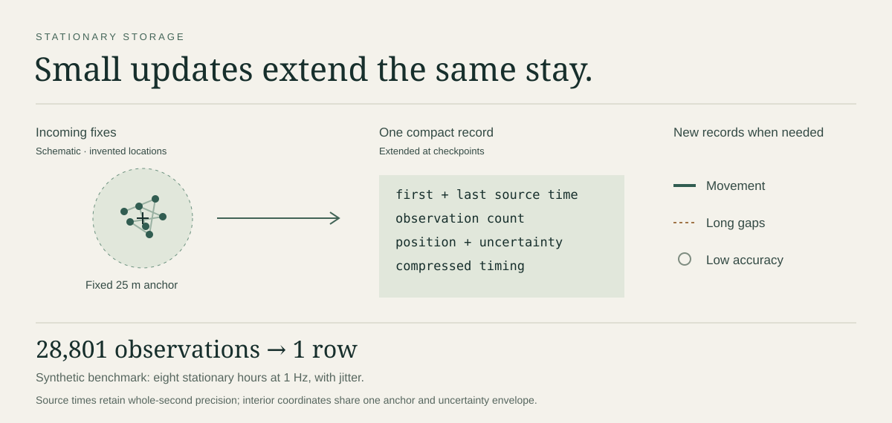

# FindMy Ledger

Record shared Find My locations on Windows and keep a compact, searchable history.

Ledger follows one participant, combines stationary updates into stays, and produces timelines and recurring-place reports from a local SQLite database. It runs in the background with no dashboard. A local coding agent can query the history to answer questions about where someone went and when.

[Demo](#try-the-demo) · [Reports](#query-your-history) · [Windows setup](docs/windows-emulator.md) · [Documentation](#documentation)

## Try the demo

The demo creates four weeks of fictional history, including movement, GPS drift and missing updates. It runs offline with Python 3.12+; no Apple account or runtime assets are needed.

From the project directory in PowerShell:

```powershell
py -3.13 -m venv .venv
$python = '.\.venv\Scripts\python.exe'
& $python -m pip install -e .
& $python -m research.demo --output data/demo
```

Use a new output directory for each run. On macOS or Linux, create the environment with `python3 -m venv .venv` and use `.venv/bin/python`.

One day in the demo looks like this:

```text
September 21, 2026 · fictional data
America/New_York

08:00–08:55   Maple Corner
09:00–11:55   Alder Studio
12:00–12:10   Harbor Library
12:10–13:00   No observations
13:00–16:55   Alder Studio
17:00–17:55   Juniper Park
```

These are first and last observations, so arrival and departure may fall outside those times. See the [full transcript](examples/demo.txt) and [JSON report](examples/demo-day.json).

## Query your history

Give an agent the database path and participant alias, then ask:

- “Where did they go on September 21, between 8am and 6pm in New York time?”
- “Which places show up regularly on weekday mornings over the last month?”

The CLI returns named spans, transitions, gaps and recurring weekday patterns:

```powershell
& $python -m location_ledger `
    --db data/demo/history.sqlite `
    analyze synthetic-participant `
    --start '2026-09-21T08:00:00-04:00' `
    --end '2026-09-21T18:00:00-04:00' `
    --timezone America/New_York --offline
```

Place names can come from your own labels or optional free Photon / OpenStreetMap lookups, cached locally. Online lookups send a representative coordinate for each new area; no API key or paid service is used. [Report options and place names](docs/place-analysis.md).

## Compact storage

Small location changes extend the current stay instead of adding rows. By default, movement beyond a fixed 25-metre anchor starts a new record, as do long gaps and poor accuracy. Every accepted source second and observation count is retained; coordinates within a stay are represented by its anchor and uncertainty.



The database uses a single primary-key index for participant and time. See [storage design and benchmarks](docs/storage.md) for the schema, compression rules and measurements.

## Windows collection

The native Live receiver runs on Windows without keeping Find My open on a viewing phone or Mac. Setup requires Apple sign-in and separately obtained emulator sources and Apple runtime files; those assets are not included here. Follow the [Windows setup guide](docs/windows-emulator.md), then [install the background collector](docs/operations.md).

The collector reconnects interrupted sessions, checkpoints history and uses a watchdog for process recovery. History and backups are ordinary, unencrypted SQLite files; saved Apple credentials use Windows DPAPI. This is an unofficial Apple integration; [development notes](docs/research.md) track remaining work.

## Documentation

| Guide | Contents |
| --- | --- |
| [Reports and place names](docs/place-analysis.md) | Time windows, recurring patterns and cached map lookups |
| [Storage](docs/storage.md) | Stay compression, indexing, benchmarks and optimization |
| [Collector operations](docs/operations.md) | Scheduling, recovery, backups and retention |
| [JSONL imports](docs/imports.md) | Bring in observations from another source |
| [Local data](docs/privacy.md) | Credentials, history files and collection controls |
| [Development notes](docs/research.md) | Current work and protocol references |

[Contributing](CONTRIBUTING.md) · [Preparing a source release](docs/public-release.md)

## License

Original Ledger code and documentation use [Apache 2.0](LICENSE). Adapted Onitrack code retains MIT; optional runtimes have their own terms. See [third-party notices](THIRD_PARTY_NOTICES.md). FindMy Ledger is not affiliated with Apple.

---

*FindMy Ledger is intended only for use with the participant's consent to collect, store and analyze their location history.*
